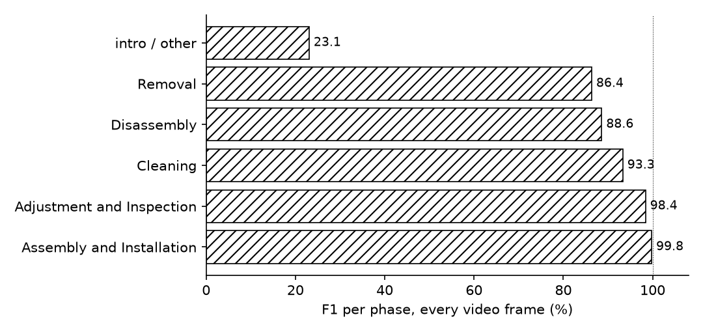

# AssemblyVision validation report

**An answer to Professor Kim's Week 11 review** (validation, not features). Team 4, QiSens capstone, 2026-11-28.

**What this report rests on.** All results are for git tag `validation-freeze-1` (commit 866fba2), which fixes the code,
the configs, the phase descriptions and the model checksums (docs_team/freeze/validation-freeze-1.json). Every QiSens number
here is a summary that Khurshid ran on the server and approved; no QiSens frame, video or label left the server or was read
by the assistant that wrote this report. Sources: docs_team/validation_segmentation.md, validation_measurements.md,
train_domain_test.md, experiments/w12-robustness/table.md and experiments/w12-train-domain/table.md.

**The one thing to keep in mind.** There is one QiSens video. Its results are development results on that video. The
evidence beyond it comes from robustness on the same video, an independent public train domain test, and public keypoint
data for two measurements.

## 1. Summary

| claim | result | verdict |
| --- | --- | --- |
| The phases are found as well as two people agree | 93.20 % frame accuracy, against 98.49 % agreement of the two annotators | about 5 points below the human ceiling |
| The result does not depend on whose labels are used | 93.21 against Asel, 92.38 against Kazi | holds |
| The result is not a lucky setting | 33 variants (weights, description halves, independent descriptions, VLM sampling, pose model): 90.04 to 94.40 | robust in every group |
| The method works on other railway video, untuned | 13 of 14 public clips (92.86 %, chance 16.7 %); joined video 89.69 % | holds on a small public set |
| The pre chosen setting was not the best one | pre chosen Z1 83.14, default Z2 93.20 chosen after both were seen | disclosed (section 2.5) |
| The 10 company measurements are validated | 3 meet their target (#3, #5, #6 in part), 5 miss, 2 not scored | partly; see section 5 |

## 2. Segmentation

### 2.1 Test set and ground truth

| item | value |
| --- | --- |
| videos | 1 (the QiSens maintenance video), 596 s, 17,892 frames |
| classes | 5 ordered phases (Removal, Disassembly, Cleaning, Adjustment and Inspection, Assembly and Installation) plus intro / other |
| annotators | 2 (Asel and Kazi), labelling independently in whole seconds; only the start times of the phases are boundaries |
| agreement | Cohen's kappa **0.980**, frame agreement **98.49 %**, mean difference of the phase starts 1.80 s, largest 5.00 s |
| final labels | the midpoint of the two annotators where they differ by 2 s or less |
| first boundary | set to 23 s (Asel's value) by the team lead, who checked it against the video |

The final labels are built from both annotators, so the system is also scored against each annotator alone, and the
agreement of the two annotators is the human ceiling.

### 2.2 Metrics

- **Frame accuracy:** the share of frames with the correct label, intro / other included (evaluated at 15 frames per second;
  the per phase tables use every video frame).
- **Edit score:** 100 x (1 minus the normalised Levenshtein distance) between the predicted and the true sequence of segment
  labels, intro / other excluded. With this decoder it carries almost no information: the decoder is given the five phases
  in their order, so it is 100 whenever all five are found.
- **Segmental F1@k** (Lea et al. 2017, as in MS TCN): each predicted segment, in time order, is a true positive if its IoU
  (overlap over the span of the two) with the not yet matched true segment of the same label is at least k (0.10, 0.25,
  0.50); else a false positive; unmatched true segments are false negatives; F1 = 2 TP / (2 TP + FP + FN). With 5 segments
  one segment is worth 20 points, so F1 is coarse here.
- **Boundary MAE:** for each true boundary, the distance to the nearest predicted boundary, averaged.

### 2.3 Result

| run | frame accuracy | against Asel | against Kazi | edit | F1@10 / 25 / 50 | MAE s |
| --- | --- | --- | --- | --- | --- | --- |
| **Engine B zero shot (flagship)** | **93.20** | 93.21 | 92.38 | 100 | 100 / 100 / 100 | 8.09 |
| Engine A (YOLO26 l) | 75.02 | 74.74 | 74.42 | 100 | 100 / 100 / 80 | 29.35 |
| Engine B v1 | 67.26 | - | - | 100 | 100 / 100 / 40 | 39.06 |
| Engine B v2 | 52.50 | - | - | 100 | 80 / 60 / 20 | 35.51 |

The flagship's stored scores use SigLIP at 2 samples per second and VLM windows of 2 s with 4 frames. The default pipeline
(1 sample per second, 3 s windows with 2 frames) gave 92.97 to 93.40 over 3 full runs (median 93.40) in 270.62 s.



| phase | F1 |
| --- | --- |
| intro / other | 23.08 |
| Removal | 86.36 |
| Disassembly | 88.60 |
| Cleaning | 93.33 |
| Adjustment and Inspection | 98.42 |
| Assembly and Installation | 99.79 |

**Confusion matrix.** The full matrix stays on the server (it is drawn from the frame counts in data/qisens/validation). The
figure is made with the command in section 8 and goes into figures/confusion_flagship.png once approved.

### 2.4 Error analysis

- **Most of the error is the intro:** 600 of the 690 intro frames (20 of 23 s) are predicted as Removal. The system starts the
  first phase at the start of the video instead of at 23 s. Without the intro, the five work phases reach F1 86 to 100.
- **Only neighbouring phases are confused:** no frame is given to a phase that is not next to the true one, as expected from
  an ordered decoder that can only move boundaries.
- Removal and Disassembly have the lowest F1 of the work phases; the later phases are near the ceiling.

### 2.5 Disclosure

1. **One video,** no independent test set: development results on that video.
2. **Phase descriptions** (docs_team/phase_descriptions.md) were written and committed once, on 2026-11-12 (commit 742bd1c),
   before the first zero shot QiSens run, without any QiSens frame or label, and never changed. Earlier QiSens scores of
   other engines (A, B v1, B v2) were known at the time.
3. **The pre chosen setting was Z1 = 83.14.** The rule selected it on public IKEA ASM data before any QiSens run.
4. **The default was changed after seeing the results:** Z2 (untuned equal weights) gave 93.20 and became the default with
   both scores known. So 93.20 is optimistically biased; an honest range for the method on this video is 83.14 to 93.20.
5. **Earlier engines were developed on the same video,** although no QiSens label was ever used to train a model.
6. **The decoder is given the task structure** (the five phases and their order); it says where the phases are, not what they are.
7. **The VLM carries most of the gain:** without it Z2 falls from 93.20 to 66.21.
8. **The freeze:** every result is for tag validation-freeze-1; later changes touched only the interface, the report and new
   tools, checked by tools/freeze.py (method unchanged).

## 3. Robustness on the same video

Rule experiments/w12-robustness/rule.md, written before any variant ran. A variant is within tolerance at 88.20 to 98.20
(5 points around 93.20); a group of several variants is robust if at least 80 % are within.

| group | n | min | median | max | within 5 points | verdict |
| --- | --- | --- | --- | --- | --- | --- |
| a. weights (VLM, SigLIP, crop at 0.5x and 2x; temperature at 0.5x and 2x) | 8 | 90.04 | 93.20 | 94.40 | 100 % | robust |
| b. description subsets (11 of 22 per phase, 20 seeds) | 20 | 90.55 | 93.20 | 94.40 | 100 % | robust |
| c. independent descriptions (three local text language models) | 3 | 92.56 | 92.62 | 93.06 | 100 % | robust |
| d. VLM sampling (3 s windows, 2 frames) | 1 | 93.40 | 93.40 | 93.40 | 100 % | robust |
| e. pose model (YOLO26 l instead of x) | 1 | 94.01 | 94.01 | 94.01 | 100 % | robust |

**Robust overall:** 33 variants, the lowest 90.04. Groups b and c change only the SigLIP text, not the VLM prompt.

**Group c authors.** No independent human authors were available, so local text only language models of different families
wrote the descriptions from the phase definitions alone (no image or video), one generation each with a fixed prompt, seed
and temperature. Two replacements were decided by Khurshid after seeing only their incomplete outputs, before any group c
score existed; every attempt is kept as a record.

| order | model | family | lines per phase | complete | used | score |
| --- | --- | --- | --- | --- | --- | --- |
| 1 | Qwen3 4B | Qwen | 22, then stopped | no | replaced | - |
| 2 | Llama 3.2 3B Instruct | Llama | 23 each | yes | yes | 93.06 |
| 3 | Gemma 3 4B it | Gemma | 20, 17, 16, 15, 15 | yes | yes | 92.56 |
| 4 | Phi 4 mini instruct | Phi | 36, 28, 38, 27, 275 (repeating, cut at 4,096 tokens) | no | replaced | - |
| 5 | Mistral 7B Instruct v0.3 | Mistral | 21 each | yes | yes | 92.62 |

## 4. Generalization: public train domain test

Rule experiments/w12-train-domain/rule.md, written before the run; one pass on the tag, B zero shot untuned, all classes as
candidates.

| test | result | reference |
| --- | --- | --- |
| clip classification, 14 public railway maintenance clips, 6 classes | **13 of 14 (92.86 %)** | chance 16.7 %, most frequent class 42.9 % |
| joined video (the 14 clips in a seeded order, no order given to the decoder) | frame accuracy **89.69**, edit 90.91, F1@10 / 25 / 50 95.24 / 85.71 / 85.71, MAE 2.43 s | |

The one misclassified clip: 17352127 (7.9 s), true Locomotive Firing and Fueling, predicted Track and Ballast Maintenance.

**Limits:** 14 short public clips (one clip is about 7 points); unbalanced classes (6 of 14 are Track and Ballast
Maintenance, and the error went to it); one annotator (Khurshid); Gemini made the classes (a chat that watched the clips) and
the descriptions (a second chat that saw only the class table), so the class set fits these clips.

## 5. The 10 company measurements

Targets frozen on 2026-11-26, before any scoring. Hand labels: one annotator (Khurshid); #3 and #6 on the public COCO 2017 val
keypoints.

| # | measurement | result | target | verdict |
| --- | --- | --- | --- | --- |
| 1 | process time | boundary MAE 8.09 s; 4 of 5 phase durations within 10 % | MAE at most 10 s, every phase within 10 % | misses (4 of 5) |
| 2 | movement path | not scored (no walk of known distance) | within 20 % over a walk | not scored |
| 3 | waist bending (COCO) | exact band 0.955, within one band 0.999, 2.58 deg; bent subset over 45 deg: 0.747 | 80 % exact, 95 % within one | meets (bent subset below) |
| 4 | repetitive work | not scored | F1 at least 0.70 | not scored |
| 5 | improvable motions | 3 of 4 suggestions useful, 1 partly useful: 0.75 | at least 60 % useful | meets |
| 6 | hand travel (COCO) | wrist PCK@0.1 0.935; travel not measurable from single images | PCK 85 %, travel within 20 % | PCK part met |
| 7 | tool pickup time | *value from the last score run, to be pasted* | recall and precision at least 0.70 | misses |
| 8 | object placement time | *value from the last score run, to be pasted* | recall and precision at least 0.70 | misses |
| 9 | two hand cooperation | *value from the last score run, to be pasted* (close to the target) | agreement at least 75 % | misses |
| 10 | gaze direction | *value from the last score run, to be pasted* | agreement at least 70 % | misses |

**Why each miss, and the fix:**
- **#1 process time:** one of the five phase durations is more than 10 % off, mostly because the intro is counted into Removal
  (section 2.4). Fix: detect the intro (start of work) before the phases; the boundary MAE target is met.
- **#2 movement path:** not scored because the QiSens video has no walk between points of known distance. Fix: record one short
  walk over a taped distance with the same camera.
- **#4 repetitive work:** not scored because the event clip was not labelled; besides, the system finds short repeated motions
  (0.4 to 2 s) while a person marks work cycles, so the definitions must first be brought together.
- **#5 improvable motions:** meets the target. Dr. Choi commented that a long phase may contain several processes: a "long
  phase" suggestion may be a phase that should be split, which points to sub step segmentation (section 7).
- **#7 and #8 tool pickup and object placement:** the detector (YOLO26 m, COCO classes) does not know factory tools (no wrench,
  hammer or drill), so most real events are invisible to it. Fix: an open vocabulary detector prompted with the tool names.
- **#9 two hand cooperation:** close to the target. The rule (both wrists above a speed threshold) counts a holding hand as idle
  and fast idle motion as work; a hand state model would close the gap.
- **#10 gaze direction:** the head keypoints (nose, eyes, ears) are too crude to tell where a worker looks, especially in a
  handheld view; a head pose or gaze model is needed.

## 6. Limits

- **One QiSens video.** Every QiSens number is a development result on it; there is no second video to test on.
- **One annotator for the measurements** (and for the train domain test), so no human agreement is known there.
- **COCO domain gap.** #3 and #6 are validated on everyday photos of mostly upright people, not on factory footage; the bent
  subset (exact band 0.747) is the part closest to QiSens and the weakest.
- **The default was chosen after seeing the result** (section 2.5), and the VLM carries most of the accuracy.
- **Small public sets:** 14 clips in the train domain test.

## 7. Future work

- **Sub step segmentation:** split each phase into its steps, both from the standard operating procedure (SOP based) and
  discovered by the VLM in the video; this also answers Dr. Choi's comment on long phases.
- **Open vocabulary tool detection** for tool pickup and object placement (#7, #8).
- **A second QiSens video,** for a real test of the method on unseen footage, and a short walk of known distance for #2.

## 8. Commands for the figures (Khurshid runs them)

```
source ~/AssemblyVision/av.sh
cd ~/AssemblyVision/code
python -m assemblyvision.tools.report_figures confusion --run-id run_20261108_133251_1550
```

It reads only the frame counts of data/qisens/validation/validation_segmentation.json and writes
data/qisens/validation/figures/confusion_run_20261108_133251_1550.png (black and white). Copy it to
docs_team/figures/confusion_flagship.png once approved. The per phase F1 figure (figures/per_phase_f1.png) was made from the
numbers in this report with `python -m assemblyvision.tools.report_figures f1`.
